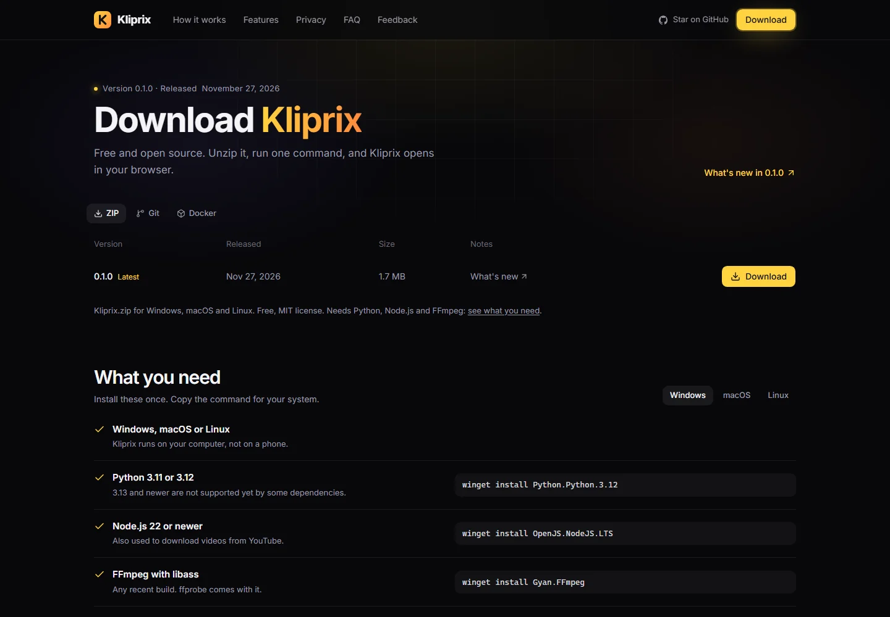
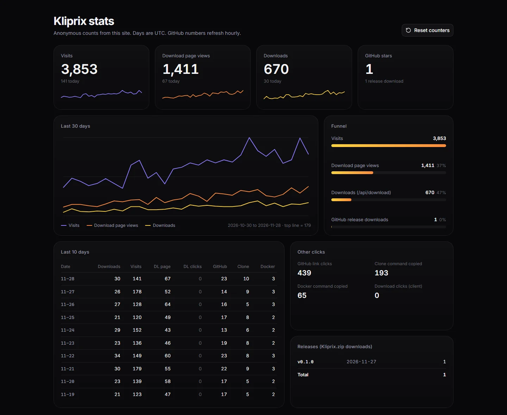

# Kliprix website

The website for [Kliprix](https://github.com/sandeshlawhale/Kliprix), a free, open-source app
that turns long streams and videos into vertical shorts, right on your own computer.

**[kliprix.vercel.app](https://kliprix.vercel.app)** · [Download](https://kliprix.vercel.app/download) · [The app on GitHub](https://github.com/sandeshlawhale/Kliprix) · [Releases](https://github.com/sandeshlawhale/Kliprix/releases) · [Report a problem](https://github.com/sandeshlawhale/Kliprix/issues)


## About Kliprix

Paste a link to a long video, press Start, and come back to finished shorts. Kliprix reads the
chat, the audio, the motion and what's being said to find the best moments, then cuts them into
1080×1920 clips with word-by-word captions, a title and ready-to-post text. English or Hinglish.

It runs on your computer, uses whichever AI you already have (Gemini, Claude, OpenAI,
OpenRouter, or a local model), and costs nothing. No account, no watermark, and your videos
never leave your PC.

This repository is only the website. The app lives in
[sandeshlawhale/Kliprix](https://github.com/sandeshlawhale/Kliprix).

## The site

**Home** (`/`): what Kliprix does, real clips it made, how it works, the features, a side-by-side
with cloud clipping tools, an FAQ and a feedback form.

**Download** (`/download`): every release with its date and size, what you need installed
(with a copyable command for Windows, macOS or Linux), and three ways to install: the ZIP, Git,
or Docker. After the ZIP starts downloading, the page walks you through the first run.



**Stats** (`/stats`): a private page, behind a password, for the owner. Visits, downloads, a
30-day chart, the funnel from visit to download, GitHub stars and release downloads, and a
button to reset the counters. It isn't linked anywhere and search engines are told to skip it.



<sub>The stats screenshot uses sample numbers.</sub>

## Privacy

The app has no analytics at all. The website counts a few things so we know whether it's
working: visits, download page views, downloads, GitHub link clicks and copied install commands.

- No cookies, no IDs, no personal data. The browser sends only the name of the event.
- No IP addresses are stored. To stop spam, each visitor gets 30 events a minute, tracked by a
  salted hash of their IP that disappears after 60 seconds.
- Bots and link previews aren't counted.
- If the counter is down, downloads still work.

## Run it locally

You need Node.js 22 or newer.

```bash
npm install
npm run dev          # http://127.0.0.1:3100
```

The site works without any setup; the counters just switch off. To use the real database, link
the folder to the Vercel project and pull the settings:

```bash
vercel link
vercel env pull .env.local
```

Other commands: `npm test`, `npm run lint`, `npm run typecheck` and `npm run build`.

## Settings

Set these in Vercel under **Settings → Environment Variables**. The names, without values, are
in [`.env.example`](.env.example).

| Name | What it's for |
|---|---|
| `KV_REST_API_URL`, `KV_REST_API_TOKEN` | Added by the Upstash for Redis integration. Where the counts live |
| `IP_HASH_SALT` | A long random string, used to hash IPs for the rate limit |
| `STATS_PASSWORD` | The password for `/stats` and its reset button. Without it, `/stats` stays locked |
| `GITHUB_TOKEN` | Optional. A token with no permissions, so `/stats` and `/download` don't hit GitHub's rate limit |

## Editing the content

Everything you'd normally change is in `data/`:

- **`data/site.json`**: the site address, the app's GitHub repo, the latest version, its release
  date and notes link, the download link, and the feedback form address.
- **`data/reviews.json`**: reviews shown under the feedback form. It starts empty. Copy in only
  real reviews you've received.

**After a new app release**, update `version`, `releaseDate` and `releaseNotesUrl` in
`data/site.json`. The download link always points to the latest release, and the table on
`/download` picks up new releases from GitHub by itself within the hour.

**Feedback** goes privately to [Formspree](https://formspree.io), which emails it to you.
Nothing is posted publicly. Put your form's address in `reviewFormEndpoint`.

**Share previews** (WhatsApp, LinkedIn, X and others) use `public/og.jpg`. If you change the
clips, run `scripts/make-share-image.py` (needs Pillow) to rebuild it and the icons.

**Clips** in `public/media/` are short loops cut from real Kliprix exports. Before sharing the
site widely, swap any clip made from someone else's video for one you own or have permission
to use.

## Deploying

The site is hosted on Vercel and deploys from `main`. Push to `main` and it's live a minute
later; every pull request gets its own preview link. Everything except `/stats` and the small
`/api` routes is static and served from Vercel's CDN.

## Built with

[Next.js](https://nextjs.org) 16, React 19, [Tailwind CSS](https://tailwindcss.com) 4,
[shadcn/ui](https://ui.shadcn.com), [Motion](https://motion.dev) for the animations, and
[Upstash Redis](https://upstash.com) for the counts. AI provider logos are from
[Lobe Icons](https://github.com/lobehub/lobe-icons) (MIT) and belong to their owners. Fonts are
Inter and Montserrat (SIL Open Font License).

## License

MIT, like [the app](https://github.com/sandeshlawhale/Kliprix).
